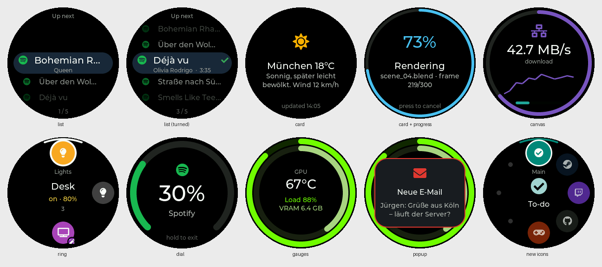

# KnobDeck

A Stream-Deck-style controller for the **[Espressif ESP32-C3-LCDkit](https://docs.espressif.com/projects/esp-dev-kits/en/latest/esp32c3/esp32-c3-lcdkit/user_guide.html)** (round 1.28" screen + rotary knob).

Up to 8 tiles sit in a ring around the round screen. **Turn** the knob to pick one, **press** to run it,
**hold** to go back. A small app on your PC (**Windows or Linux**) runs the actions and has a settings window
where you build the pages.


```
knobdeck/
  firmware/            ESP-IDF project for the deck (C, LVGL)
    prebuilt/          ready-to-flash image (no ESP-IDF needed)
    sim/               desktop simulator that renders the UI to images
  pc/                  PC app (Python, Windows + Linux): tray icon, settings window, plugins
    examples/          example plugins (actions, a stopwatch screen)
  PROTOCOL.md          USB message format between deck and PC
  PLUGINS.md           how to write your own actions
```

## What it can do

| Tile type | On the deck | Examples |
|---|---|---|
| **Screen** | a full screen drawn by a plugin – list, card, canvas, ring, dial or gauges – that gets every turn and press | power menu, app launcher list, timer (popup + sound + LED when done), live network graph |
| **Action** | press runs it on the PC; the tile can change colour/label live | media keys, hotkeys, open apps/websites, run scripts, mic mute (turns red), OBS scenes, record/stream (turns red when live), lock PC |
| **Dial** | full-screen arc; turning changes the value, pressing toggles | system volume (press = mute), per-app volume (Spotify, Discord, ...) |
| **Stats** | three live rings + clock | CPU / GPU / RAM load and temperatures, network + disk |
| **Voice** | the people in your voice chat around the edge, a green ring on whoever speaks | Discord voice channel (press on yourself = mute, on someone else = mute them for you) |
| **Folder** | opens another page | group apps, OBS controls, ... |
| **Back** | goes back a page | |

The screen dims and shows a clock after a while (configurable). Holding the knob on the home page runs an
optional *long-press* action of the selected tile.

**Plug and play**: KnobDeck starts by itself when you plug the deck in, and the deck carries your settings – pages,
actions, pictures and plugin settings. Plug it into another PC with KnobDeck installed and everything is there;
change something on either PC and the other one picks it up the next time the deck is plugged in.

Plugins can also pop up notifications over anything on screen, set the board's RGB LED, play sounds on its
speaker, and send infrared codes (*IR remote* action: learn a button from any remote, then send it from a tile –
TV, amplifier, LED strips). The firmware is a generic engine for all of that: new plugins never need new firmware.



## 1. Flash the firmware

**Easiest: in the browser (Chrome or Edge), no tools needed**

1. Plug the deck into the PC with a USB-C *data* cable.
2. Open <https://espressif.github.io/esptool-js/> (on Linux the browser needs access to the port - easiest after
   running the PC app's `install.sh`, which sets that up), click **Connect** and pick the port (USB JTAG/serial debug unit).
3. Set *Flash Address* to `0x0`, choose `firmware/prebuilt/knobdeck-esp32c3-lcdkit-v2.1.0.bin`, click **Program**.
4. When it's done, press the **RESET** button on the board. The deck shows its home page and "PC offline".

If Connect fails: hold **BOOT**, tap **RESET**, release **BOOT** and try again.

**Updating later**: once the PC app runs, *Device* tab > **Firmware** shows when the app has a newer firmware
and updates the deck with one click (tiles and pictures stay on the deck). If the update can't reach the deck:
unplug it, keep the knob pressed (it doubles as the BOOT button) while plugging it back in, and try again.

**Or build it yourself** (to change the firmware): install ESP-IDF 5.3 or newer (Windows: the *ESP-IDF Tools
Installer*), then in the ESP-IDF command prompt:

```
cd firmware
idf.py set-target esp32c3
idf.py build flash
```

The board files (display, knob) and LVGL are downloaded automatically by the ESP-IDF component manager.
Close the KnobDeck PC app first: it keeps the USB port busy.

## 2. Install the PC app

### Windows 10/11

1. Install Python 3.13 (3.10-3.13 work; on 3.14+ the settings open in the browser instead of their own
   window): install the *Python install manager* from the Microsoft Store, then run `py install 3.13`
   in a terminal.
2. Double-click `pc/install.bat` (one time; creates a private environment and installs the packages).
3. Double-click `pc/KnobDeck.bat`. A knob icon appears in the tray and the settings window opens.

The deck connects by itself: the dot in the settings window turns green and the deck shows your pages.
To start KnobDeck with Windows: *Device* tab > *Start KnobDeck with Windows* (or right-click the tray icon).

### Linux

Tested on Ubuntu 24.04; Debian, Fedora, Arch and openSUSE are supported by the installer. X11 and Wayland.

```
cd pc
./install.sh
```

It asks before each step that needs `sudo`:

* **System packages**: tray icon (AppIndicator), settings window (WebKit), `playerctl` (media control),
  `xdotool` / `wl-clipboard` (typing text).
* **A udev rule** (`/etc/udev/rules.d/60-knobdeck.rules`) so your user can open the deck's USB port and
  `/dev/uinput` (the virtual keyboard for hotkeys and media keys) without root, and so ModemManager leaves the
  deck alone. Unplug and replug the deck afterwards; if hotkeys still don't work, log out and in once.
* A Python environment in `pc/.venv` and a *KnobDeck* entry in your app menu.

Start it from the app menu or with `./KnobDeck.sh` (`./KnobDeck-console.sh` runs it in the terminal with a
detailed log). *Device* tab > *Start when I log in* adds it to your desktop's autostart.

What's different on Linux:

| | |
|---|---|
| Volume, mic, app volume | PulseAudio or PipeWire (`pulsectl`); *App volume* takes the program name, e.g. `spotify`, `firefox` |
| Media keys | through `playerctl` (MPRIS: Spotify, browsers, VLC, mpv ...), otherwise as key presses |
| Hotkeys | virtual keyboard (`/dev/uinput`, works on X11 and Wayland), otherwise `xdotool` (X11) or `ydotool` |
| Type text | `xdotool` on X11; on Wayland `wtype` (KDE, Sway, Hyprland), otherwise it pastes via the clipboard |
| Lock, sleep, restart, power off | `loginctl` / `systemctl`; *Screen off* on X11, KDE and GNOME |
| CPU / GPU temperature | read directly (no extra tool); NVIDIA via NVML, AMD via the amdgpu driver |
| Open app | a command (`firefox`), a file or folder (`~/Documents`), a URL, or a `.desktop` file |
| Tray icon | GNOME needs the *AppIndicator* extension (Ubuntu has it); without it use the app menu entry |
| Discord | desktop app, also Flatpak and Snap |

## 3. Set up your deck

* Click a slot on the round preview to edit it, an empty one (+) to add a tile. Drag tiles to rearrange them,
  or onto another page in the list to move them.
* Pick an icon from the symbols, upload any image (PNG/JPG/SVG/ICO, transparent PNGs look best) or use up to
  5 letters.
* **Test on PC** runs the action right away. **Save to deck** sends everything to the deck (also with Ctrl+S).
* *Device* tab: brightness, dim timeout, knob direction, click sound, firmware update.
* *Plugins* tab: OBS connection (OBS: *Tools > WebSocket Server Settings*), CPU temperature source.

Labels can use umlauts and accents (firmware 2.0; with older firmware they're converted: Grüße → Gruesse).

**IR remote**: add an *Action* tile, choose *IR remote > Send IR code*, click **Learn from remote**, point the
remote at the deck and press the button. On the ESP32-C3-LCDkit the IR LED and the IR receiver share GPIO 4 –
the jumper J7 on the main board selects which one is connected, so set it to *RX* while learning and to
*TX* for sending (if your board revision uses another pin: *Device > Advanced > IR pin*).

## Starting on plug-in and settings on the deck

* **Auto-start** (*Device* tab > *Start KnobDeck automatically*, on by default):
  * **Linux**: the udev rule from `install.sh` starts KnobDeck (as the user service `knobdeck.service`) the moment
    the deck is plugged in. Nothing runs while the deck isn't connected.
  * **Windows** can't start a program on a USB event by itself, so KnobDeck starts hidden when you log in – no
    window, no tray icon – and appears in the tray when you plug the deck in (it uses very little while waiting).
  * Other choices: *When I log in* (tray icon always there) or *Off*.
* **Settings on the deck** (firmware 2.1+): every time you save, the full settings are also stored on the deck.
  When you plug the deck in:
  * a PC with a fresh KnobDeck install loads the deck's settings,
  * if only the deck's settings changed (edited on another PC), this PC loads them,
  * if only this PC's settings changed, they're stored on the deck,
  * if both changed, the newer ones win.
  Before loading anything, the previous settings are kept in `backups` in the settings folder (*Device* tab >
  *Undo last load*). Passwords and secrets (OBS password, Discord client secret and login) and the USB port setting
  stay on each PC and are never stored on the deck. Your own plugin files (`.py`) aren't copied either – copy them
  to the other PC yourself.

## Discord setup (one time, about 2 minutes)

Discord only lets apps you registered yourself read your voice channel. Registering is free:

1. Open <https://discord.com/developers/applications> and log in with your Discord account.
2. **New Application**, name it e.g. `KnobDeck`, accept the terms, **Create**.
3. Open **OAuth2** in the menu on the left:
   * copy the **Client ID**,
   * click **Reset Secret** and copy the **Client Secret** (it's only shown once),
   * under **Redirects** click **Add Redirect**, enter `http://localhost`, and **Save Changes**.
4. In KnobDeck's settings window: **Plugins** tab > **Discord**: paste both values, press **Save to deck**.
5. The Discord desktop app pops up an **Authorize** window for "KnobDeck" - click **Authorize**. Done; the
   status line in the Plugins tab says *Connected as ...*. You won't be asked again.

Then add a tile of type **Voice** (source: *Voice channel*), and if you like *Mute microphone (Discord)* and
*Deafen (Discord)* actions. Join a voice channel and open the Voice tile on the deck. Avatars appear after a
second or two (they're downloaded once and stored on the deck).

The Client Secret and the login token stay on your PC (`%APPDATA%\KnobDeck`). Discord must be the desktop app
(not the browser version). If Discord reports an error about scopes or testers, open your application in the
Developer Portal and make sure you're logged in with the same account that you use in the Discord app.

## Notes and troubleshooting

* **Deck shows "PC offline"**: the app isn't running, or another program has the COM port open (Arduino IDE,
  a serial monitor, ESP-IDF monitor). Try *Reconnect* in the tray menu.
* **Knob turns the wrong way**: *Device* tab > *Reverse knob direction*.
* **CPU temperature missing**: Windows doesn't expose it. Install LibreHardwareMonitor, enable *Options >
  Remote Web Server*, and put `http://localhost:8085/data.json` into *Plugins > PC stats*.
* **GPU stats**: NVIDIA cards are supported out of the box (via NVML).
* **Hotkeys don't reach a program**: programs running as administrator only accept simulated keys from
  programs that also run as administrator.
* Log file and settings: `%APPDATA%\KnobDeck\` on Windows, `~/.config/knobdeck/` on Linux (`knobdeck.log`,
  `config.json`, `icons`, `plugins`). `KnobDeck-console.bat` / `KnobDeck-console.sh` run with detailed logging.
* **Linux: "No permission to open /dev/ttyACM0"**: run `install.sh` again and let it add the udev rule (or add
  yourself to the `dialout` group - `uucp` on Arch - and log out and in), then replug the deck.
* **Linux: hotkeys do nothing**: the *Device* tab shows how keys are sent. If it mentions `/dev/uinput`, the udev
  rule is missing or you need to log out and in once. In GNOME, *Show desktop* needs a shortcut for *Hide all
  normal windows* (Settings > Keyboard > Shortcuts).

## Extending it

* New PC actions and screens: drop a `.py` file into `%APPDATA%\KnobDeck\plugins\` (Linux:
  `~/.config/knobdeck/plugins/`) - see
  [PLUGINS.md](PLUGINS.md), `pc/examples/hello_plugin.py` and `pc/examples/stopwatch_plugin.py`. They show up in
  the settings window after a restart.
* The firmware is a generic engine: six screen templates, popups, LED, sound, IR, pictures up to 128×128 and
  Latin text, and it forwards every knob event to the PC. It reports what it supports when it connects, so
  plugins never need firmware changes. The message format is in [PROTOCOL.md](PROTOCOL.md).
* UI changes: `firmware/main/ui.c`. `firmware/sim` renders the real UI code to PNGs on a desktop (Linux/WSL),
  so you can iterate without flashing.

## How it works

The ESP32-C3's USB port is a serial port (it can't act as a USB keyboard), so the deck sends events such as
`{"t":"press","id":"mic"}` over USB and the PC app does the work. The PC pushes the layout, pictures
(stored in the deck's flash), live state and plugin screens back. The layout is stored on the deck, so it appears
immediately after power-up, even before the PC app connects.
